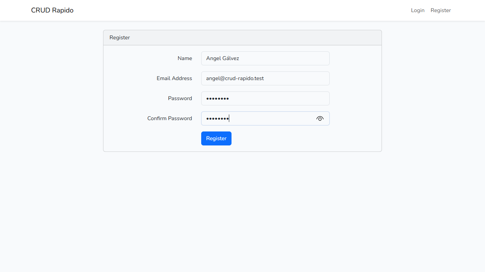
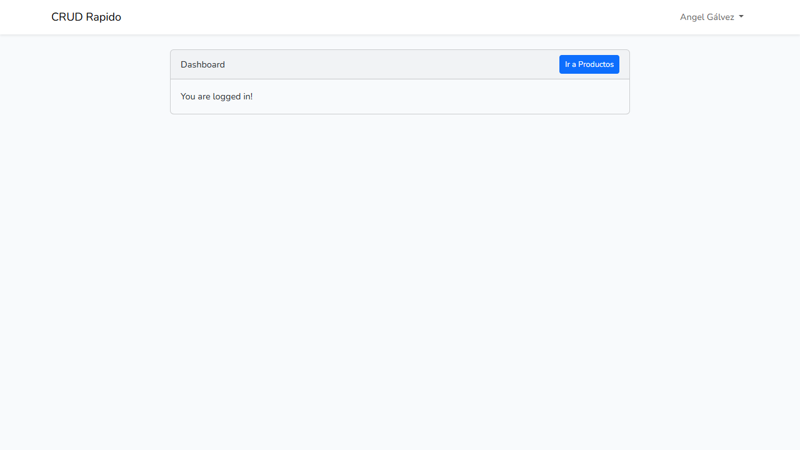
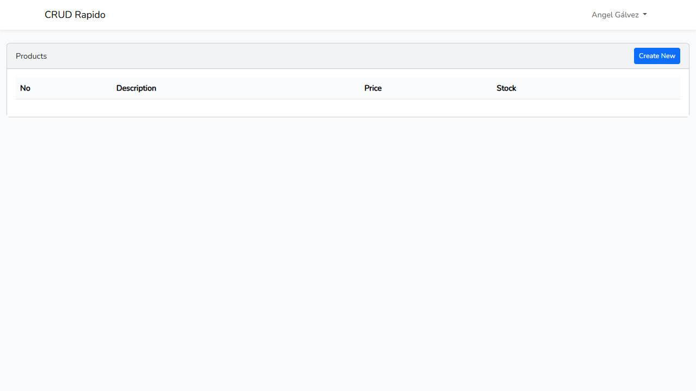
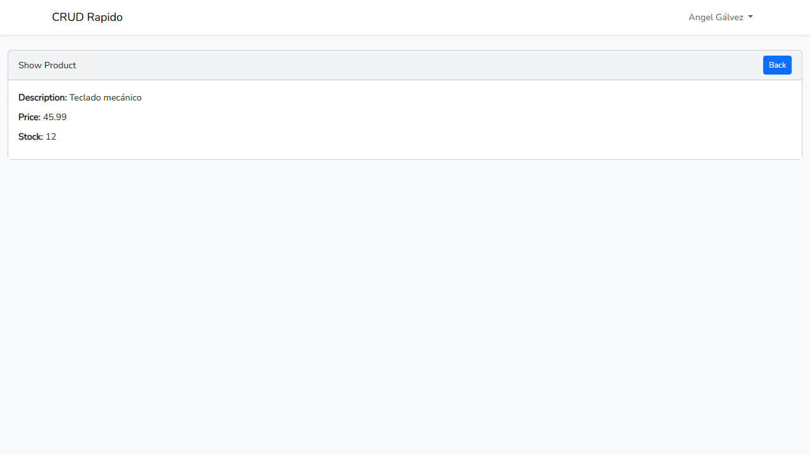
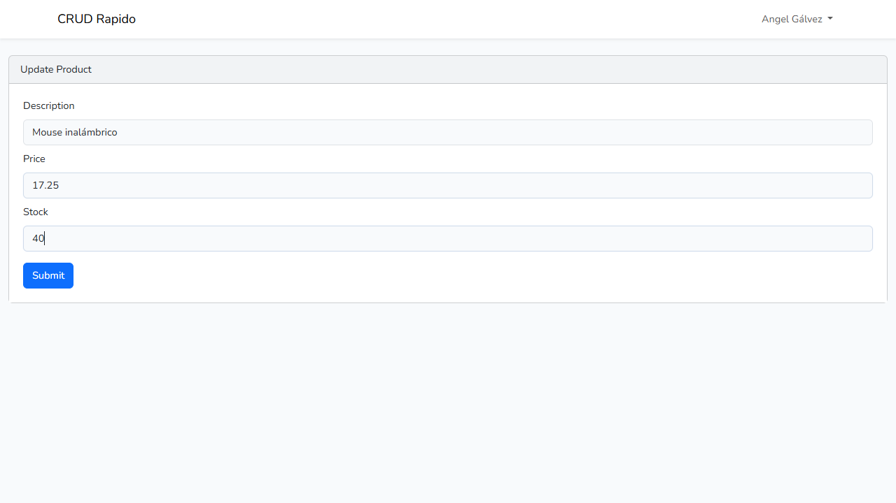
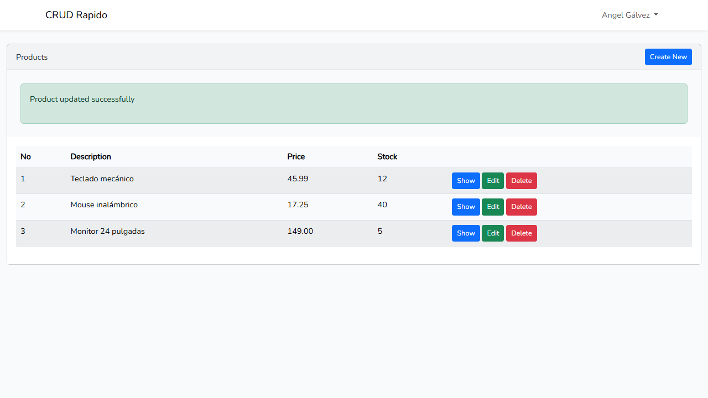
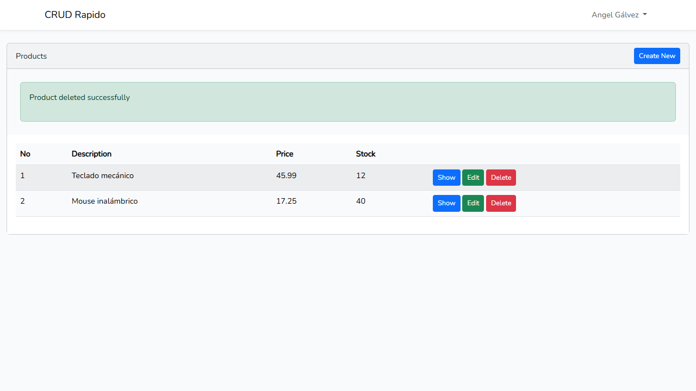
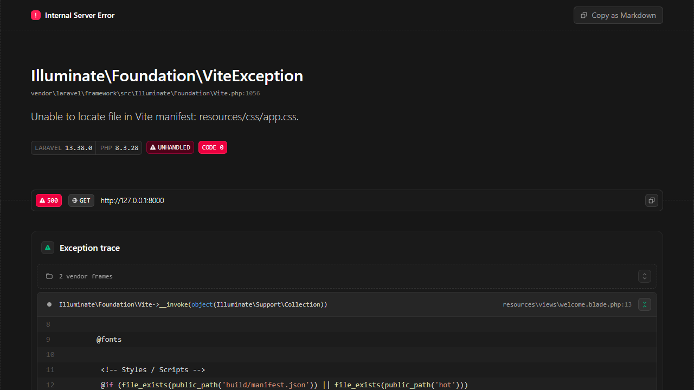
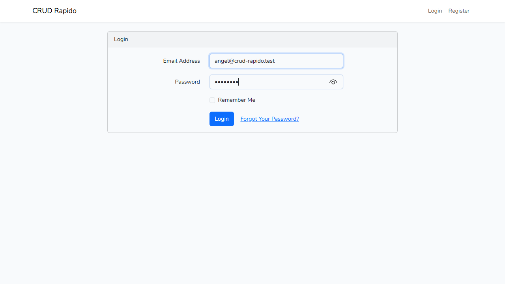

<div align="center">

&nbsp;&nbsp;&nbsp;&nbsp;&nbsp;&nbsp;

# UNIVERSIDAD TECNOLÓGICA DE PANAMÁ

**FACULTAD DE INGENIERÍA DE SISTEMAS COMPUTACIONALES**<br>
**CAMPUS VÍCTOR LEVIS SASSO**<br>
**DESARROLLO WEB**

## 🛒 Laboratorio #2 – Acercamiento a un CRUD rápido en Laravel

**Unidad I: Modelo Vista Controlador (MVC)** · **Tema:** Patrón MVC<br>
**Lenguaje de programación:** PHP · **II Semestre 2026**<br>
**Instructor:** Ing. Irina Fong

<br>


</div>

---

## 📑 Tabla de contenido

1. [Requisitos previos](#1-requisitos-previos)
2. [Introducción](#2-introducción)
3. [Resultado del laboratorio](#3-resultado-del-laboratorio)
4. [Base de datos](#4-base-de-datos)
5. [Dificultades y soluciones](#5-dificultades-y-soluciones)
6. [Conceptos de la guía](#6-conceptos-de-la-guía)
7. [Referencias](#7-referencias)
8. [Fecha de ejecución del laboratorio](#8-fecha-de-ejecución-del-laboratorio)

---

## 1. Requisitos previos

### 1.1 Prerrequisitos (ecosistema de desarrollo del laboratorio)

| | Tecnología | Requisito | Versión utilizada |
|:---:|---|---|---|
|  | **PHP** | Versión 8.0 o superior (Laravel 13 exige 8.3+) | 8.3.28 |
|  | **Composer** | Última versión estable | 2.10.3 |
|  | **Laravel** | Laravel Installer (`laravel new`) | Installer 5.32 · Framework 13.38 |
| 🖥️ | **Paquete de servidor local** | XAMPP, WampServer o Laragon | WampServer (64 bits) |
|  | **Servidor web** | Apache o Nginx | Apache 2.4.65 |
|  | **Base de datos** | MySQL/MariaDB funcionando | MySQL 8.4.7 |
|  | **Editor de código** | Visual Studio Code (recomendado) | Visual Studio Code |
|  | **Node.js / NPM** | Sí fue necesario: compila Bootstrap y Sass con Vite | Node 24.22.1 · npm 11.19.1 |
|  | **Sistema operativo** | — | Windows 11 Home |
|  | **Git / GitHub** | Control de versiones y entrega | Git · GitHub |

### 1.2 Instalación desde este repositorio

```bash
git clone <url-de-este-repositorio> crud_rapido
cd crud_rapido
composer install            # dependencias de PHP (vendor/)
npm install                 # dependencias de Node (node_modules/)
copy .env.example .env      # Linux/macOS: cp .env.example .env
php artisan key:generate
# crear la base de datos crud_rapido en phpMyAdmin (o importar el backup, sección 4.5)
php artisan migrate
npm run build
php artisan serve           # http://127.0.0.1:8000
```

### 1.3 Secuencia de comandos utilizada en el laboratorio (según la guía)

```bash
# 1. Instalar el Laravel Installer (no estaba en el equipo)
composer global require laravel/installer

# 2. Crear el proyecto (guía: C:\wamp64\www> laravel new crud_rapido)
cd C:\wamp64\www
laravel new crud_rapido --database=mysql --phpunit --npm --no-boost
cd crud_rapido

# 3. Variables de entorno (.env) y Schema::defaultStringLength(191)  → ver sección 2

# 4. Limpiar cachés y migrar
php artisan config:clear
php artisan migrate          # crea users, cache, jobs, sessions...
php artisan cache:clear
php artisan config:cache
php artisan config:clear     # para que Laravel vuelva a leer el .env en desarrollo

# 5. Login con Laravel/UI + Bootstrap
composer require laravel/ui --dev
php artisan ui bootstrap --auth
npm install
npm run build

# 6. Modelo + migración de productos
php artisan make:model Product -m
php artisan migrate

# 7. Generador de CRUD
composer require ibex/crud-generator --dev
php artisan vendor:publish --tag=crud
php artisan make:crud products bootstrap

# 8. Rutas y autoload
composer dump-autoload
php artisan route:list --path=products

# 9. Levantar el sistema
composer run dev             # servidor + cola + Vite a la vez
# o bien
php artisan serve
```

### 1.4 Dependencias utilizadas

| Gestor | Paquete | Función |
|---|---|---|
| Composer | `laravel/framework ^13` | Núcleo del framework |
| Composer (dev) | `laravel/ui ^4.6` | Login, registro, recuperación de contraseña y vistas con Bootstrap |
| Composer (dev) | `ibex/crud-generator ^2.1` | Genera el controlador, el modelo, el Form Request y las vistas del CRUD |
| npm | `bootstrap ^5.3` · `@popperjs/core` · `sass` | Estilos de las vistas |
| npm | `vite` · `laravel-vite-plugin` | Compilación de `resources/sass/app.scss` y `resources/js/app.js` |

---

## 2. Introducción

### 🎯 Objetivo del laboratorio

Construir rápidamente un **CRUD (Create, Read, Update, Delete) de productos** en Laravel, protegido por un **login** hecho con `laravel/ui`, usando el paquete **`ibex/crud-generator`** para generar automáticamente el controlador, el modelo, las vistas y la validación. Así se refuerza el patrón **Modelo-Vista-Controlador (MVC)** y el manejo de **migraciones** sobre MySQL.

### 🗂️ Carpetas principales según la arquitectura MVC

| Componente | Carpeta | Función | Archivos de este laboratorio |
|---|---|---|---|
| **Rutas** | `routes/` | Asocian cada URL con un controlador | [routes/web.php](routes/web.php) |
| **Controladores** | `app/Http/Controllers/` | Reciben la petición, usan el modelo y devuelven una vista | [ProductController.php](app/Http/Controllers/ProductController.php), `HomeController`, `Auth/*` |
| **Validación** | `app/Http/Requests/` | Reglas de los formularios (Form Request) | [ProductRequest.php](app/Http/Requests/ProductRequest.php) |
| **Modelos** | `app/Models/` | Representan las tablas con Eloquent ORM | [Product.php](app/Models/Product.php), `User.php` |
| **Vistas** | `resources/views/` | Plantillas Blade (HTML) | [product/](resources/views/product/) (`index`, `create`, `edit`, `show`, `form`), [home.blade.php](resources/views/home.blade.php) |
| **Migraciones** | `database/migrations/` | Estructura de las tablas en código | [create_products_table](database/migrations/2026_10_23_012927_create_products_table.php) |
| **Proveedores** | `app/Providers/` | Configuración al arrancar la app | [AppServiceProvider.php](app/Providers/AppServiceProvider.php) |

Flujo de una petición del CRUD:

```
Navegador ──► routes/web.php ──► ProductController ──► ProductRequest (valida)
    ▲                                   │
    │                                   ▼
    └──── Vista product/*.blade.php ◄── Modelo Product ◄──► MySQL (tabla products)
```

### 💻 Código implementado

**`.env`**: variables de entorno (guía, diapositiva 5)

```dotenv
APP_NAME="CRUD Rapido"
DB_CONNECTION=mysql
DB_HOST=127.0.0.1
DB_PORT=3306
DB_DATABASE=crud_rapido
DB_USERNAME=root
DB_PASSWORD=
DB_ENGINE=InnoDB
```

> En la guía aparece `DB_PASSWORD=demo`. En este equipo el usuario `root` de WampServer no tiene contraseña, así que se dejó vacío.

**`AppServiceProvider`**: `Schema::defaultStringLength(191)` (diapositivas 7 y 8)

```php
use Illuminate\Pagination\Paginator;
use Illuminate\Support\Facades\Schema;

public function boot(): void
{
    // Evita el error de longitud de cadena en índices de MySQL
    Schema::defaultStringLength(191);

    // La paginación del CRUD usa los estilos de Bootstrap del login
    Paginator::useBootstrapFive();
}
```

**Migración `create_products_table`** (diapositiva 15)

```php
Schema::create('products', function (Blueprint $table) {
    $table->id();
    $table->string('description');
    // En Laravel 13 double() no acepta precisión; decimal(8, 2) da 8 dígitos con 2 decimales
    $table->decimal('price', 8, 2);
    $table->integer('stock');
    $table->timestamps();
});
```

**Modelo `Product`** con `$fillable` (diapositivas 39 a 42)

```php
class Product extends Model
{
    protected $perPage = 20;

    protected $fillable = ['description', 'price', 'stock'];
}
```

**Rutas**: `routes/web.php` (diapositivas 22 y 23)

```php
use App\Http\Controllers\ProductController;
use Illuminate\Support\Facades\Route;

Route::get('/', function () {
    return view('welcome');
});

Auth::routes();

Route::get('/home', [App\Http\Controllers\HomeController::class, 'index'])->name('home');

// CRUD completo de productos: index, create, store, show, edit, update y destroy
Route::resource('products', ProductController::class);
```

**Controlador `ProductController`** (generado por `make:crud`, fragmento)

```php
public function index(Request $request): View
{
    $products = Product::paginate();

    return view('product.index', compact('products'))
        ->with('i', ($request->input('page', 1) - 1) * $products->perPage());
}

public function store(ProductRequest $request): RedirectResponse
{
    Product::create($request->validated());   // asignación masiva protegida por $fillable

    return Redirect::route('products.index')
        ->with('success', 'Product created successfully.');
}

public function update(ProductRequest $request, Product $product): RedirectResponse
{
    $product->update($request->validated());

    return Redirect::route('products.index')
        ->with('success', 'Product updated successfully');
}

public function destroy($id): RedirectResponse
{
    Product::find($id)->delete();

    return Redirect::route('products.index')
        ->with('success', 'Product deleted successfully');
}
```

**Validación `ProductRequest`**

```php
public function rules(): array
{
    return [
        'description' => 'required|string|max:191',
        'price' => 'required|numeric|min:0|max:999999.99',
        'stock' => 'required|integer|min:0',
    ];
}
```

> El generador solo ponía `required` en `price` y `stock`. Se añadió `numeric` e `integer` para que un valor como "abc" muestre un mensaje de error en el formulario, en lugar de provocar un error de MySQL.

**Vista `home.blade.php`**: botón "Ir a Productos" (diapositiva 34)

```blade
<div class="card-header d-flex justify-content-between align-items-center">
    <span>{{ __('Dashboard') }}</span>
    <a href="{{ url('/products') }}" class="btn btn-sm btn-primary">Ir a Productos</a>
</div>
```

### 🛣️ Rutas generadas por `Route::resource` (`php artisan route:list --path=products`)

| Método | URI | Nombre | Acción |
|---|---|---|---|
| GET | `/products` | `products.index` | Listar productos |
| GET | `/products/create` | `products.create` | Formulario de creación |
| POST | `/products` | `products.store` | Guardar producto |
| GET | `/products/{product}` | `products.show` | Ver un producto |
| GET | `/products/{product}/edit` | `products.edit` | Formulario de edición |
| PUT/PATCH | `/products/{product}` | `products.update` | Actualizar producto |
| DELETE | `/products/{product}` | `products.destroy` | Eliminar producto |

Además, `Auth::routes()` crea `/login`, `/logout`, `/register` y `/password/*`.

### 🛠️ Comandos utilizados para las migraciones

| Comando | Qué hace |
|---|---|
| `php artisan migrate` | Ejecuta las migraciones pendientes y crea las tablas. |
| `php artisan migrate:fresh` | Elimina **todas** las tablas y vuelve a ejecutar todas las migraciones desde cero. Se usó para resolver un estado inconsistente (ver dificultad 2). |
| `php artisan migrate:rollback` | Revierte solo el último lote de migraciones. Es más seguro que `migrate:fresh`. |
| `php artisan migrate:status` | Muestra qué migraciones se ejecutaron. |
| `php artisan make:model Product -m` | Crea el modelo `Product` y, con `-m`, su migración `create_products_table`. |

---

## 3. Resultado del laboratorio

### Listado de productos después de crear 3 registros


<table>
<tr>
<td align="center"><b>1. Registro</b> (<code>/register</code>)<br><br></td>
<td align="center"><b>2. Home con "Ir a Productos"</b> (<code>/home</code>)<br><br></td>
</tr>
<tr>
<td align="center"><b>3. Listado vacío</b> (<code>/products</code>)<br><br></td>
<td align="center"><b>4. Crear</b> (<code>/products/create</code>)<br><br></td>
</tr>
<tr>
<td align="center"><b>5. Ver</b> (<code>/products/1</code>)<br><br></td>
<td align="center"><b>6. Editar</b> (<code>/products/2/edit</code>)<br><br></td>
</tr>
<tr>
<td align="center"><b>7. Producto actualizado</b> (precio 19.50 → 17.25, stock 30 → 40)<br><br></td>
<td align="center"><b>8. Producto eliminado</b> (se borró el monitor)<br><br></td>
</tr>
<tr>
<td align="center"><b>Página de bienvenida</b> (<code>/</code>)<br><br></td>
<td align="center"><b>Inicio de sesión</b> (<code>/login</code>)<br><br></td>
</tr>
</table>

Usuario de prueba creado en el laboratorio: `angel@crud-rapido.test` / `password`. Es solo para el entorno local.

---

## 4. Base de datos

### 4.1 Entorno

| Elemento | Valor |
|---|---|
| Motor | MySQL 8.4.7 (WampServer) |
| Administración | phpMyAdmin |
| Base de datos | `crud_rapido` (utf8mb4 / utf8mb4_unicode_ci) |
| Motor de almacenamiento | InnoDB (configurado en el proyecto, ver dificultad 3) |
| Usuario / contraseña | `root` / *(vacía, entorno local)* |

### 4.2 Aspectos de Laravel

- **`.env`**: define la conexión (`DB_*`). Laravel la lee desde [config/database.php](config/database.php). Antes de migrar hay que verificar que las credenciales sean correctas (diapositiva 5).
- **`config/database.php`**: se cambió `'engine' => null` por `'engine' => env('DB_ENGINE', 'InnoDB')` para que todas las tablas se creen en InnoDB.
- **Migraciones**: crean las tablas en código PHP con la clase `Schema`, que permite crear, modificar y eliminar tablas.
- **Caché y sesiones**: `CACHE_STORE=database` y `SESSION_DRIVER=database` guardan la caché y las sesiones en tablas de MySQL.

### 4.3 Comandos para levantar las tablas

```sql
CREATE DATABASE crud_rapido CHARACTER SET utf8mb4 COLLATE utf8mb4_unicode_ci;
```

```bash
php artisan migrate             # tablas base de Laravel
php artisan make:model Product -m
php artisan migrate             # tabla products
```

### 4.4 Tablas resultantes

| Migración | Tablas |
|---|---|
| `0001_01_01_000000_create_users_table` | `users`, `password_reset_tokens`, `sessions` |
| `0001_01_01_000001_create_cache_table` | `cache`, `cache_locks` |
| `0001_01_01_000002_create_jobs_table` | `jobs`, `job_batches`, `failed_jobs` |
| `2026_10_23_012927_create_products_table` | `products` |

Estructura de `products`:

| Campo | Tipo |
|---|---|
| `id` | bigint unsigned, PK, auto_increment |
| `description` | varchar(191) |
| `price` | decimal(8,2) |
| `stock` | int |
| `created_at`, `updated_at` | timestamp |

### 4.5 💾 Respaldo (backup)

📁 [database/backup/crud_rapido.sql](database/backup/crud_rapido.sql)

```bash
mysqldump -u root --routines --triggers --databases crud_rapido --ignore-table=crud_rapido.sessions > database/backup/crud_rapido.sql
mysqldump -u root --no-data --skip-add-drop-table crud_rapido sessions >> database/backup/crud_rapido.sql
```

> De `sessions` solo se respaldó la estructura, para no publicar tokens de sesión.

Restaurar:

```bash
mysql -u root < database/backup/crud_rapido.sql
```

---

## 5. Dificultades y soluciones

- **Dificultad 1: `php artisan cache:clear` falló antes de migrar** con `Table 'crud_rapido.cache' doesn't exist`.
  - **Solución:** con `CACHE_STORE=database` la caché vive en la tabla `cache`, que crea la migración. Se ejecutó primero `php artisan migrate` y después `cache:clear`.

- **Dificultad 2: `migrate` decía `Table 'users' already exists`**, aunque la tabla `migrations` estaba vacía. Un intento anterior había quedado a medias.
  - **Solución:** como la base era nueva y no tenía datos, se usó `php artisan migrate:fresh` (diapositiva 11), que borra todas las tablas y migra desde cero.

- **Dificultad 3: `Specified key was too long; max key length is 1000 bytes`**, aunque ya estaba `Schema::defaultStringLength(191)` (diapositivas 6 y 7).
  - **Solución:** al revisar la variable `storage_engine`, igual que en la diapositiva 6, se encontró que el MySQL de WampServer tenía `default_storage_engine = MyISAM`. MyISAM solo permite índices de hasta 1000 bytes; InnoDB permite 3072. Se configuró `'engine' => env('DB_ENGINE', 'InnoDB')` en `config/database.php` y `DB_ENGINE=InnoDB` en el `.env`, y se volvió a ejecutar `migrate:fresh`. No se cambió la configuración global de MySQL para no afectar otras bases de datos.

- **Dificultad 4: `$table->double('price', 8, 2)` de la guía ya no aplica en Laravel 13.** El método `double()` solo recibe el nombre de la columna e ignora el `8, 2`.
  - **Solución:** se usó `$table->decimal('price', 8, 2)`, que sí guarda 8 dígitos con 2 decimales y además es el tipo correcto para precios.

- **Dificultad 5: `php artisan make:crud products` se quedaba esperando.** La versión 2.1 del paquete pide el *stack* (`bootstrap`, `tailwind`, `livewire` o `api`) y pregunta si debe sobrescribir el modelo `Product` creado antes.
  - **Solución:** se ejecutó `php artisan make:crud products bootstrap` (mismo estilo que el login) y se respondió `y` para que el generador completara el modelo con `$fillable`.

- **Dificultad 6: después de cerrar `composer run dev` quedó el archivo `public/hot`**, que hace que Laravel siga buscando los estilos en el servidor de Vite apagado.
  - **Solución:** se borró `public/hot` y se usó `npm run build` para servir los assets compilados. Es el mismo tipo de problema que el error *Unable to locate file in Vite manifest* de la diapositiva 35.

---

## 6. Conceptos de la guía

### `php artisan config:clear`
Laravel une toda la configuración de `config/` en un solo archivo en caché (`bootstrap/cache/config.php`) para no leer muchos archivos en cada solicitud. `config:clear` borra esa caché y hace que Laravel vuelva a tomar los valores actualizados del `.env`. `config:cache` la vuelve a generar.

### `ibex/crud-generator`
Paquete que genera automáticamente **controladores, modelos, vistas, Form Requests y rutas** a partir de una tabla existente.

1. `composer require ibex/crud-generator --dev`: instala el paquete solo para desarrollo.
2. `php artisan vendor:publish --tag=crud`: copia los archivos que el paquete registró con la etiqueta `crud` desde `vendor/` a la aplicación. En este caso copió `config/crud.php`.
3. `php artisan make:crud products bootstrap`: `make:crud` es el comando Artisan que añadió el paquete. `products` es el nombre de la tabla y `bootstrap` el estilo de las vistas. Generó `ProductController`, `Product`, `ProductRequest` y `resources/views/product/*`.

### `composer dump-autoload`
Actualiza el mapa de clases de PHP cuando se crean, mueven o eliminan archivos, para que el autoload reconozca las clases nuevas, como `ProductController`, sin `require` manuales. Con `-o` genera un mapa optimizado para producción.

### `$fillable` y `$guarded`: protección contra asignación masiva
- **Asignación masiva:** pasar un array completo, por ejemplo `$request->all()`, a `create()`, `update()` o `fill()`.
- **`$fillable`:** lista **qué campos sí** se pueden asignar en masa. En `Product`: `description`, `price` y `stock`. Cualquier otro campo, como `id`, se ignora.
- **`$guarded`:** funciona al revés: lista **qué campos no** se pueden asignar. `$guarded = ['*']` bloquea todos.
- **Por qué es importante:** evita que alguien modifique columnas sensibles enviando campos extra en un formulario.

### Laravel Breeze (documentado, no instalado)
La guía indica que no es necesario instalarlo, pero que se documenta. Breeze es la alternativa oficial y moderna a `laravel/ui`. Funciona de forma nativa con Vite y Axios, publica sus vistas Blade en `resources/views/auth/` y usa Tailwind CSS.

```bash
composer require laravel/breeze --dev
php artisan breeze:install
```

Opciones recomendadas en el instalador interactivo: stack **`blade`**, modo oscuro **no**, y testing **Pest (0)** o **PHPUnit (1)**.

---

## 7. Referencias

1. Fong, I. (2026). *Acercamiento a un CRUD rápido en Laravel: Guía del Laboratorio #2 de CRUD con Laravel* [Presentación]. Universidad Tecnológica de Panamá.
2. Video de referencia de la guía: https://www.youtube.com/watch?v=j5baJsM_Adc&t=111s
3. Laravel. (2026). *Database: Migrations*. https://laravel.com/docs/migrations
4. Laravel. (2026). *Eloquent: Mass Assignment*. https://laravel.com/docs/eloquent#mass-assignment
5. Laravel. (2026). *Controllers: Resource Controllers*. https://laravel.com/docs/controllers#resource-controllers
6. Ibex. (2026). *ibex/crud-generator* [Repositorio]. GitHub. https://github.com/awais-vteams/laravel-crud-generator
7. Laravel. (2026). *laravel/ui* [Repositorio]. GitHub. https://github.com/laravel/ui
8. Oracle. (2026). *The InnoDB Storage Engine: Limits*. MySQL 8.4 Reference Manual. https://dev.mysql.com/doc/refman/8.4/en/innodb-limits.html

---

## 8. Fecha de ejecución del laboratorio

📅 **22 de octubre de 2026**

---

<div align="center">

Este laboratorio ha sido desarrollado por el estudiante de la **Universidad Tecnológica de Panamá**:

**Nombre:** Angel Gálvez<br>
**Correo:** angel.galvez2@utp.ac.pa<br>
**Curso:** Desarrollo Web (Grupo 1S3122)<br>
**Instructor del Laboratorio:** Irina Fong

</div>
